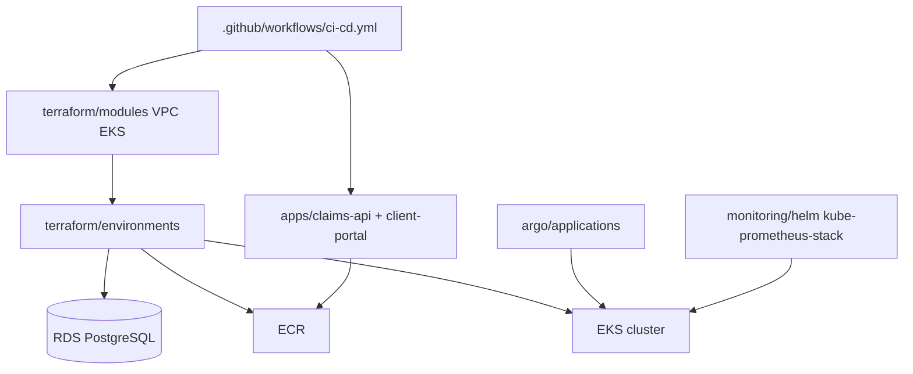

# Insurance Platform Infrastructure

Terraform modules and sample apps for a rebuildable insurance platform foundation.

[](https://github.com/justrunme/insurance-platform-infrastructure/actions/workflows/ci-cd.yml)
[](https://github.com/justrunme/insurance-platform-infrastructure/releases/latest)
[](LICENSE)
[](https://justrunme.com/cases/terraform-platform-modules/)
[](https://securityscorecards.dev/viewer/?uri=github.com/justrunme/insurance-platform-infrastructure)

Case study: [Terraform Platform Modules](https://justrunme.com/cases/terraform-platform-modules/) · [Andrey Lesnikov](https://justrunme.com/)

## What it does

- Defines Terraform modules for VPC/EKS and environment stacks (RDS, ECR, S3)
- Includes sample Claims API (Go) and Client Portal (React) with Argo CD application manifests
- Runs GitHub Actions CI for lint/test, Trivy, and optional AWS deploy jobs

## Why

- Insurance-style platforms need repeatable networking and EKS foundations, not one-off click-ops
- App and GitOps manifests stay in-repo so infrastructure changes can be rehearsed locally

## Quickstart

```bash
make setup
make test
make lint
make docker-build
```

## Architecture



### Infrastructure
- **Infrastructure as Code**: Terraform modules for VPC and EKS; RDS, ECR, and S3 defined per environment
- **Container Orchestration**: AWS EKS
- **GitOps**: Argo CD application manifests under `argo/applications/`
- **Monitoring**: kube-prometheus-stack Helm values (Prometheus, Grafana, Alertmanager)
- **Security scanning**: Trivy in CI; encrypted RDS and EKS secrets via KMS

### Application Services
- **Claims API**: Go service (Gin) under `apps/claims-api`
- **Client Portal**: React (Create React App + Material UI) under `apps/client-portal`
- **Database**: PostgreSQL on Amazon RDS (environment Terraform)
- **Container Registry**: Amazon ECR repositories (environment Terraform)

### Security
- Trivy filesystem scan in CI (SARIF upload)
- Non-root container images
- VPC isolation and security groups for EKS/RDS
- Kubernetes RBAC and service accounts in manifests

## Quick Start

### Prerequisites
- Docker
- kubectl
- Terraform >= 1.16
- Go >= 1.27
- Node.js >= 24
- Optional: Minikube or another local cluster for `make k8s-deploy`

### Local Development

1. **Clone the repository**
   ```bash
   git clone <repository-url>
   cd insurance-platform-infrastructure
   ```

2. **Install development tools**
   ```bash
   make setup
   ```

3. **Run tests and linting**
   ```bash
   make test
   make lint
   ```

4. **Build Docker images**
   ```bash
   make docker-build
   ```

5. **Deploy local Kubernetes manifests**
   ```bash
   make k8s-deploy
   ```

### AWS Deployment Setup

To enable AWS deployment in GitHub Actions, configure:

1. **Repository variables**
   - `AWS_ENABLED`: `true` to enable AWS jobs
   - `AWS_REGION`: e.g. `us-west-2` (workflow default)

2. **Repository secrets**
   - `AWS_ACCESS_KEY_ID`
   - `AWS_SECRET_ACCESS_KEY`
   - `AWS_ACCOUNT_ID` (for ECR registry URL)
   - `SLACK_WEBHOOK` (optional notifications)

3. **IAM permissions** for EKS, ECR, VPC, RDS, and S3 (Terraform state if using a remote backend)

4. **Optional S3 backend** (uncomment in environment `main.tf`):
   ```hcl
   terraform {
     backend "s3" {
       bucket = "your-terraform-state-bucket"
       key    = "insurance-platform/terraform.tfstate"
       region = "us-west-2"
     }
   }
   ```

### Manual Deployment Commands

**Infrastructure:**
```bash
# Development: include [deploy-infra] in the commit message on main when AWS_ENABLED=true
git commit -m "Deploy dev infrastructure [deploy-infra]"
git push

# Production: Actions → CI/CD Pipeline → Run workflow (manual)
```

**Applications:**
```bash
# On main with AWS_ENABLED=true: build/push to ECR and update GitOps manifests
git push origin main
```

## Development Workflow

### Make targets
```bash
make help               # List targets
make setup              # Install local dependencies
make test               # Go + React tests
make lint               # Terraform fmt check, go vet, eslint
make docker-build       # Build service images
make docker-run         # Run local containers
make terraform-init     # terraform init (dev)
make terraform-plan     # terraform plan (dev)
make terraform-validate # validate dev and prod
make k8s-deploy         # Apply local/Argo manifests
make security-scan      # Trivy fs scan (if installed)
make pre-commit         # Run pre-commit hooks
```

### CI/CD Pipeline

GitHub Actions (`.github/workflows/ci-cd.yml`):

**Default (no AWS):**
- Trivy scan
- `go test` / `go vet` / staticcheck for `apps/claims-api`
- `npm` lint, test, and build for `apps/client-portal`
- `terraform fmt -check`, TFLint, `terraform validate` for `terraform/`
- Docker image builds on `main` when `AWS_ENABLED` is not `true`

**With `AWS_ENABLED=true` on `main`:**
- Build and push to ECR
- Update image tags in Kubernetes/Argo manifests
- Optional infra apply when the commit message contains `[deploy-infra]`
- Production plan via `workflow_dispatch`

## Project Structure

```
├── apps/
│   ├── claims-api/          # Go microservice (+ deployments/k8s)
│   └── client-portal/       # React frontend
├── terraform/
│   ├── modules/             # vpc, eks
│   └── environments/        # dev, prod
├── argo/applications/       # Argo CD Application manifests
├── monitoring/helm/         # Prometheus/Grafana Helm values
├── docs/                    # Deployment and security notes
├── .github/workflows/       # CI/CD
└── Makefile
```

## License

MIT License — see [LICENSE](LICENSE).
